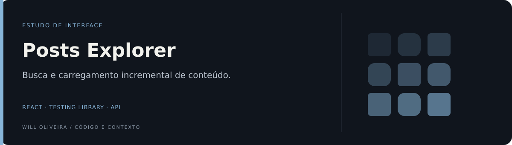

<p align="center">
  
</p>

# Posts · busca e testes de interface

Aplicação React que combina posts e imagens do JSONPlaceholder, com busca e carregamento incremental.

Estudo com Create React App e Testing Library. O nome do repositório é histórico.

## Explore o diferencial

| Ponto de entrada | O que observar |
| --- | --- |
| [Estados da busca](src/templates/Home/index.jsx) | A página reúne filtro por título, estado vazio e carregamento incremental. |
| [Composição dos dados](src/utils/load-posts.js) | O utilitário reúne posts e imagens antes de alimentar os componentes. |

## Destaques

- Consulta paralela de posts e imagens.
- Busca por título e estado vazio.
- Carregamento incremental.
- Arquivos de testes de componentes, com pontos de revisão documentados.

<details>
<summary><strong>Organização e código</strong></summary>

### Por dentro do código

| Código | O que observar |
| --- | --- |
| [`src/utils/load-posts.js`](src/utils/load-posts.js) | Consulta e combinação dos dados. |
| [`src/templates/Home/index.jsx`](src/templates/Home/index.jsx) | Busca e paginação. |
| [`src/templates/Home/Home.spec.jsx`](src/templates/Home/Home.spec.jsx) | Estrutura inicial de teste, ainda sem cenário comportamental. |
| [`src/components/Button/Button.spec.jsx`](src/components/Button/Button.spec.jsx) | Teste de componente. |

</details>

<details>
<summary><strong>Executar e consultar</strong></summary>

### Executar localmente

Requer Node.js e npm compatíveis com as dependências versionadas.

```bash
git clone https://github.com/Will-Ifes/temp-repo.git
cd temp-repo
npm install
npm start
```

Abra o endereço informado pelo servidor no terminal.

### Comandos disponíveis

| Comando | Script versionado |
| --- | --- |
| `npm start` | `react-scripts start` |
| `npm run build` | `react-scripts build` |
| `npm test` | `react-scripts test` |

</details>

<details>
<summary>Escopo e referências</summary>

A Home tem apenas um teste inicial. Os testes do Button incluem interação e estados, mas o primeiro cenário usa um nome acessível diferente do texto renderizado e precisa de correção. Esta revisão documental não executou a suíte.

Depende de APIs externas. A atualização da lista e as dependências do efeito de carregamento são pontos de revisão para evitar comportamento inesperado.

</details>

---

Mantido por **Will Oliveira** · [Perfil](https://github.com/Will-Ifes) · [LinkedIn](https://www.linkedin.com/in/wildemberg-de-jesus-oliveira/)
